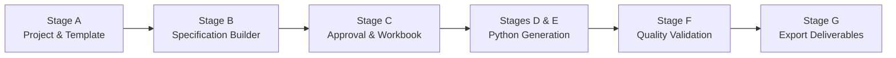

# Synthetic Data Generator

A production-oriented, modular synthetic data generation and validation platform powered by the Claude API and deterministic Python modeling.

This application automates the journey from an empty or partially completed Excel specification workbook (`.xlsx`) to a fully generated, statistically compliant synthetic dataset with automated quality validation checks and multi-format deliverables.

---

## 1. Project Purpose and Key Features

- **End-to-End Workflow**: Progresses systematically through Project Setup, AI-Assisted Specification Building, Specification Approval, Deterministic Generation, Quality Validation, and Deliverable Export.
- **Dual Runtime Modes**:
  - **Live Mode**: Integrates with the official Anthropic Python SDK using your Anthropic API key (`CLAUDE_MOCK_MODE=false`).
  - **Mock Mode**: Fully functional offline mode (`CLAUDE_MOCK_MODE=true`) requiring no API key or network access, ideal for development, CI/CD, and offline testing.
- **Excel Template Preservation**: Safely inspects input workbooks without touching original bytes; creates independent copies for filled specifications while protecting existing formulas, cell styles, dropdowns, and merged ranges.
- **Completely Generic & Domain-Agnostic**: Define **any project** across Healthcare, Agriculture, Retail & E-Commerce, Education, Manufacturing, Financial Services, or custom industries. Downstream specification proposals, schemas, constraints, generation rules, and reports adapt dynamically to your project definition.
- **Safe & Deterministic Generation**: Python execution using NumPy and SciPy; AST-based safe formula evaluation (zero `eval()` calls); Gaussian copula for multivariate correlation modeling; explicit 15% bounded noise policy.
- **Rigorous Data Quality Validation**: Executes real statistical and integrity Python checks (`PASS`, `WARNING`, `FAIL`, `NOT TESTED`) with up to 3 bounded automated repair iterations.
- **Complete Deliverable Packaging**: Generates 12 deliverable files (CSV, XLSX, DOCX, PDF, JSON, Python reproduction script, and an all-in-one ZIP package).

---

## 2. Architecture & Project Structure

```
synthetic-data-generator/
│
├── app.py                     # Multi-stage Streamlit web application
├── requirements.txt           # Project dependencies
├── .env.example               # Environment template (placeholders only)
├── .env                       # Local environment configuration
├── .gitignore                 # Git ignore rules (protects .env, venvs, outputs)
├── pytest.ini                 # Pytest configuration
├── README.md                  # Comprehensive setup and handover documentation
│
├── prompts/                   # Prompts read from disk at runtime
│   ├── specification_system.txt  # System prompt for workbook analysis
│   └── generation_system.txt     # System prompt for generation configuration
│
├── app/                       # Core modular application code
│   ├── __init__.py            # Package metadata
│   ├── config.py              # Environment configuration & credentials validation
│   ├── schemas.py             # Strongly-typed dataclasses & schema definitions
│   ├── claude_client.py       # Official Anthropic SDK client & mock engine
│   ├── workbook.py            # Openpyxl inspection, template creation & safe writing
│   ├── specification.py       # Specification validation & config conversion
│   ├── generation.py          # Deterministic generation, formulas & 15% noise policy
│   ├── validation.py          # Quality checks engine & bounded repair iterations
│   ├── documentation.py       # ReportLab PDF & python-docx report generators
│   └── export.py              # Packaging deliverables into ZIP and individual files
│
├── tests/                     # Automated pytest test suite (63 tests across multiple domains)
│   ├── test_config.py         # Config validation, placeholder detection & modes
│   ├── test_claude_client.py  # Mock responses, JSON extraction, prompt loading & errors
│   ├── test_workbook.py       # Inspection, preservation, template creation & formula safety
│   ├── test_specification.py   # Coordinate validation, spec items & config conversion
│   ├── test_generation.py     # Row counts, determinism, formulas, bounds & noise rules
│   ├── test_validation.py     # Real quality checks, failure detection & auto-repair
│   └── test_export.py         # Filename sanitization, deliverable generation & zip archives
│
└── outputs/                   # Export directory for generated files
    └── .gitkeep
```

---

## 3. Technology Stack & Prerequisites

- **Operating System**: Windows (tested with PowerShell), Linux, or macOS
- **Python**: Python 3.11
- **Hardware**: Standard CPU (no GPU required); ~8 GB RAM recommended
- **Key Libraries**:
  - `streamlit` - Web application interface
  - `anthropic` - Official Anthropic Python client
  - `pandas`, `numpy`, `scipy` - Statistical computation and vectorized generation
  - `openpyxl` - Safe Excel workbook inspection and manipulation
  - `python-docx` - Plain-language documentation and DOCX validation reports
  - `reportlab` - Quality validation PDF reporting
  - `python-dotenv` - Environment variable management
  - `pytest` - Automated testing framework

---

## 4. Installation & Setup Instructions

### Step 1: Clone the Repository
```bash
git clone https://github.com/Parul077/synthetic-data-generator.git
cd synthetic-data-generator
```

### Step 2: Create and Activate a Python 3.11 Virtual Environment

**Windows (PowerShell):**
```powershell
python -m venv venv
.\venv\Scripts\Activate.ps1
```
*(If you encounter execution policy restrictions in PowerShell, run `Set-ExecutionPolicy -Scope Process -ExecutionPolicy Bypass` first).*

**macOS / Linux:**
```bash
python3 -m venv venv
source venv/bin/activate
```

### Step 3: Install Dependencies
```bash
pip install --upgrade pip
pip install -r requirements.txt
```

### Step 4: Configure Environment Variables

For **Offline Development / Testing without an API Key** (Mock Mode):

- **Windows (PowerShell):**
  ```powershell
  Copy-Item .env.example .env
  ```
- **macOS / Linux:**
  ```bash
  cp .env.example .env
  ```

Ensure `.env` contains:
```ini
CLAUDE_MOCK_MODE=true
ANTHROPIC_API_KEY=your_api_key_here
ANTHROPIC_MODEL=claude-3-5-sonnet-20241022
# (Optional) ANTHROPIC_MAX_TOKENS: Output token limit override.
# When omitted, the system dynamically allocates the maximum capacity supported by your model
# (e.g. 8,192 for Claude 3.5 Sonnet, up to 64,000 for Claude 3.7 Sonnet) with automatic continuation.
```

For **Live Claude API Mode**:
Update `.env` with your real Anthropic API key:
```ini
CLAUDE_MOCK_MODE=false
ANTHROPIC_API_KEY=sk-ant-api03-...your_actual_key_here...
ANTHROPIC_MODEL=claude-3-5-sonnet-20241022
```

---

## 5. Running the Application

Launch the Streamlit dashboard:
```bash
streamlit run app.py
```
Open your browser to `http://localhost:8501`.

---

## 6. Application Workflow Guide

### End-to-End Pipeline Overview



### Detailed System Architecture & Execution Flowchart

```mermaid
flowchart TD
    subgraph StageA ["Stage A: Setup & Inspection"]
        A1["1. Upload Empty Specification (.xlsx)"] --> A2["2. Non-Destructive Inspection (openpyxl)"]
        A2 --> A3["3. Configure Project Metadata"]
    end

    subgraph StageB ["Stage B: AI Specification Builder"]
        B4["4. Claude Interprets Requirements<br/>(prompts/specification_system.txt)"]
        B5["5. Interactive Review & Item Approval<br/>(Manual Fallback Available)"]
        B4 --> B5
    end

    subgraph StageC ["Stage C: Validation & Workbook Export"]
        C6{"6. Pre-Generation<br/>Specification Validation"}
        C7["7. Generate Completed .xlsx Copy<br/>(Original Preserved)"]
    end

    subgraph StageDE ["Stages D & E: Deterministic Python Engine"]
        DE8["8. Convert to GenerationConfig Schema"]
        DE9["9. Generate Base Features & Copula Correlations<br/>(NumPy / SciPy)"]
        DE10["10. AST Safe Formula Evaluation<br/>(Zero eval)"]
        DE11["11. Inject Configured 15% Noise"]
        DE12["12. Re-enforce Hard Bounds & Recompute Formulas"]
        
        DE8 --> DE9
        DE9 --> DE10
        DE10 --> DE11
        DE11 --> DE12
    end

    subgraph StageF ["Stage F: Quality Validation & Repair"]
        F13["13. Execute Python Quality Checks<br/>(PASS / WARNING / FAIL / NOT TESTED)"]
        F14{"14. Bounded Repair Loop<br/>(Iteration <= 3)"}
        F15["15. Report Unresolved Issues Honestly"]
    end

    subgraph StageG ["Stage G: Packaging & Deliverables"]
        G16["16. Download Deliverables Package (.zip)"]
    end

    %% Workflow Connections & Feedback Loops
    A3 --> B4
    B5 --> C6
    C6 -- "Pass" --> C7
    C6 -- "Fail" --> B5
    C7 --> DE8
    DE12 --> F13
    F13 -- "Failures Detected" --> F14
    F14 -- "Repair" --> DE12
    F14 -- "Max Iterations Exceeded" --> F15
    F13 -- "All Checks Pass" --> G16
    F15 --> G16
```



### Stage A: Project Creation & Setup
1. Enter or review project metadata (Project Name, Domain, Country, Objective, Structure, Record Count, Random Seed).
2. Either upload an existing `.xlsx` specification workbook, or click **"Generate Template for Current Project"** in the sidebar to create an initial template tailored to your current project definition.
3. Review worksheet metadata, detected formulas, merged cells, and populated cell summaries.

### Stage B: AI-Assisted Specification Builder
1. Click **"Generate Specification Suggestions"**.
   - In Live Mode: Claude reads `prompts/specification_system.txt`, workbook metadata, and project objectives to propose structured entries.
   - In Mock Mode: A deterministic domain-specific specification is generated immediately.
2. Review proposed cell entries, justifications, and assumptions.
3. Approve, edit, or reject suggestions individually or in bulk.
4. Use the **Manual Entry Fallback** form to add custom specification items directly.

### Stage C: Specification Validation & Approval
1. Pre-generation validation checks coordinates, protects existing formulas from overwrite, and verifies sheet names.
2. Click **"Finalize & Approve Specification Workbook"**.
3. Download the completed `.xlsx` specification workbook (the original uploaded file remains completely untouched).

### Stages D & E: Synthetic Data Generation
1. Review the generated strongly-typed JSON configuration (columns, distributions, accounting identities, noise policy).
2. Click **"Generate Synthetic Dataset"**.
3. Deterministic Python generates the exact requested row count, enforces accounting equations (e.g. `Total Assets = Savings + Investments`), applies the 15% noise policy, and displays interactive data previews and summary statistics.

### Stage F: Quality Validation Engine
1. Click **"Execute Data Quality Validation Checks"**.
2. Real Python checks evaluate row counts, column sequences, ID uniqueness, ranges, categorical distributions, formulas, financial identities, and correlations.
3. If boundary or formula drifts are detected, click **"Run Bounded Automated Repair"** (up to 3 iterations) to clip out-of-bounds values and recompute derived identities.

### Stage G: Documentation & Deliverables Export
1. Download the complete all-in-one ZIP archive (`<project_name>_deliverables.zip`).
2. Download individual deliverable files:
   - Completed Specification (`.xlsx`)
   - Synthetic Dataset (`.csv` and `.xlsx`)
   - Standalone Reproduction Script (`generate_dataset.py`)
   - Dataset Documentation (`.docx`)
   - Quality Validation Report (`.docx` and `.pdf`)
   - Assumptions and Limitations Report (`.md`)
   - Machine-readable configuration & validation results (`.json`)

---

## 7. Noise Policy Specification

- **Requirement**: Configurable 15% random noise applied to eligible features.
- **Eligibility**:
  - **Included**: Continuous numerical features (e.g., `age`, `monthly_income`, `monthly_expenses`, `savings_balance`, `investment_portfolio_value`, `equity_allocation_pct`, `investment_experience_years`).
  - **Excluded / Protected**: Primary IDs (`customer_id`), categorical variables (`gender`, `city_tier`, `risk_tolerance`), dates, derived fields (`total_financial_assets`, `debt_allocation_pct`), and the target variable (`propensity_to_increase_investment`).
- **Mechanism**: Exactly 15% of records in eligible continuous columns receive bounded Gaussian relative perturbation.
- **Post-Noise Guarantee**: Hard minimum and maximum boundaries are re-clipped immediately, and derived formulas are re-evaluated so that accounting identities are 100% preserved.

---

## 8. Automated Testing

All 61 automated tests run offline in Mock Mode and require no Anthropic credentials:

```bash
pytest -v
```
*(On Windows, you can also run: `.\venv\Scripts\pytest.exe -v`)*

### Test Coverage Highlights:
- **`tests/test_workbook.py`**: Validates inspection, formula detection, merged cells, preservation of original bytes, safe specification writing, and sample template generation.
- **`tests/test_config.py`**: Validates mock mode bypass, live mode key enforcement, placeholder detection, and environment parsing.
- **`tests/test_claude_client.py`**: Validates deterministic mock output, JSON code fence extraction, prompt file loading, and Anthropic API error mapping (`AuthenticationError`, `RateLimitError`).
- **`tests/test_specification.py`**: Validates cell coordinate syntax, formula protection, missing field checks, and schema conversion.
- **`tests/test_generation.py`**: Validates exact row/column counts, deterministic seed reproducibility, AST-based safe formula evaluator, financial identities, bounds, and noise protection.
- **`tests/test_validation.py`**: Validates genuine quality checks, detection of row/boundary/category/formula breaches, and automated repair recovery.
- **`tests/test_export.py`**: Validates path traversal sanitization, deliverable generation, and ZIP archive integrity.

---

## 9. Security, Privacy & Reliability Guardrails

- **Zero API Key Exposure**: Credentials are kept in `.env` (excluded by `.gitignore`) and are never rendered in Streamlit UI, logs, reports, or generated scripts.
- **Safe Evaluation**: Derived formulas are parsed using Python's Abstract Syntax Tree (`ast.NodeVisitor`) with a strict operator whitelist. String `eval()` is strictly prohibited.
- **Filename Sanitization**: Output filenames are sanitized to prevent directory traversal attacks (`../`).
- **Privacy Notice**: Synthetic data generated by this application does not contain real personal data. It is intended for software development, model prototyping, and testing, not for regulated automated individual underwriting.

---

## 10. Known Limitations & Troubleshooting

| Issue / Symptom | Cause | Solution |
| :--- | :--- | :--- |
| `ANTHROPIC_API_KEY is missing or contains placeholder text` | Live mode (`CLAUDE_MOCK_MODE=false`) is enabled without a valid API key. | Add your Anthropic API key to `.env`, or set `CLAUDE_MOCK_MODE=true` to test offline. |
| `Data Validation extension is not supported and will be removed` | Openpyxl warning for complex Excel XML extension tags. | Automatically filtered and suppressed by the application; data validation rules remain intact. |
| `Authentication failed. Check your API key` | Expired or incorrect Anthropic API key. | Verify credentials and billing in your Anthropic Console account. |
| Streamlit page doesn't update after state change | Streamlit rerun lifecycle | Click the corresponding action button or reset session state from the sidebar. |
